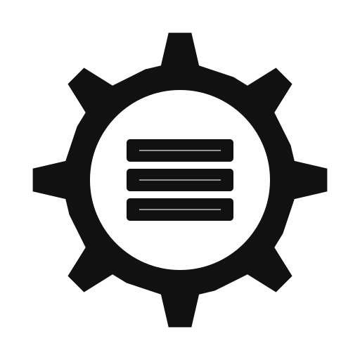

<p align="center">
  <picture>
    <source media="(prefers-color-scheme: dark)"  srcset="public/logo-dark.svg">
    <source media="(prefers-color-scheme: light)" srcset="public/logo.svg">
    
  </picture>
</p>

<h1 align="center">Auto-Dock It — Website</h1>

<p align="center">
  Marketing site for <a href="https://github.com/MelvinJoshua1375/auto-dock-it">Auto-Dock It</a>,
  the agentic AI tool that containerizes any GitHub repository.
  <br />
  Live at <a href="https://autodockit.pages.dev">autodockit.pages.dev</a>.
</p>

---

## Tech stack

- **[Next.js](https://nextjs.org/) (App Router)** with `output: "export"` — static HTML, no server at runtime.
- **TypeScript** + **[Tailwind CSS v4](https://tailwindcss.com/)** with brand tokens ported verbatim from the product.
- **[lucide-react](https://lucide.dev/)** for all icons (no emoji anywhere).
- **[next-themes](https://github.com/pacocoursey/next-themes)** for the dark/light toggle (defaults to dark, like the app).
- Deployed to **Cloudflare Pages** via GitHub Actions.

## Local development

```bash
npm install
npm run dev      # http://localhost:3000
```

## Production build

```bash
npm run build    # static export → ./out
npm run serve    # preview the exported site locally
```

The export emits `out/404.html`, which Cloudflare Pages serves automatically for
unknown routes (the custom 404 page).

## Deployment (CI/CD)

Every push to `main` triggers `.github/workflows/deploy.yml`, which builds the
static export and deploys it to Cloudflare Pages with `wrangler pages deploy`.

Required GitHub repository secrets:

| Secret | Description |
|---|---|
| `CLOUDFLARE_API_TOKEN` | Cloudflare API token with the **Cloudflare Pages: Edit** permission |
| `CLOUDFLARE_ACCOUNT_ID` | Your Cloudflare account ID |

Pages project name: **`autodockit`** (→ `autodockit.pages.dev`).

## Structure

```
app/            routes, layout, global styles, SEO routes (sitemap, robots, manifest)
components/     nav, footer, theme toggle, UI primitives, and page sections
lib/            site config, SEO metadata, structured data, FAQ + content data
public/         logos, favicon, OG image, theme-matched screenshots
.github/        Cloudflare Pages deploy workflow
```

## Assets

Logos and screenshots are sourced from the product. Screenshots are theme-matched:
light-mode captures render in light mode, dark-mode captures in dark mode.

## License

MIT — see [LICENSE](LICENSE). © 2026 Melvin Joshua & Anand Sundaramoorthy SA.
